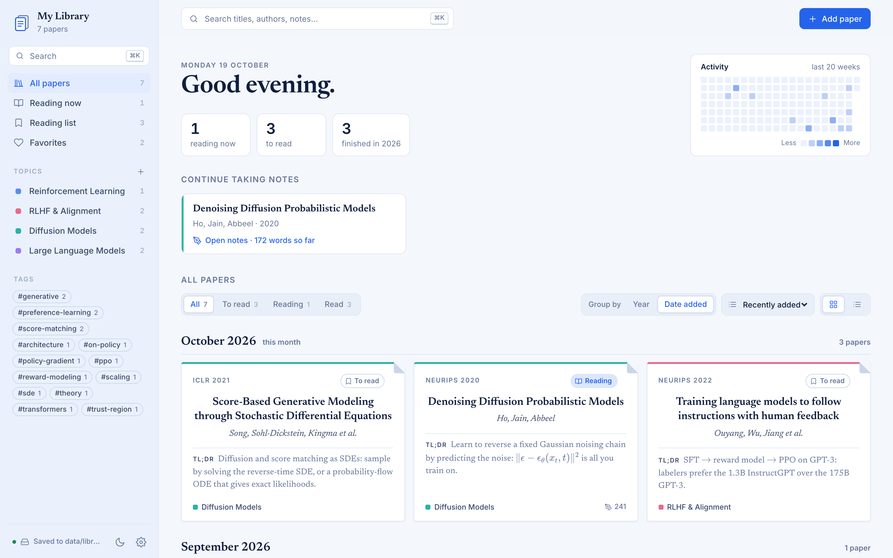
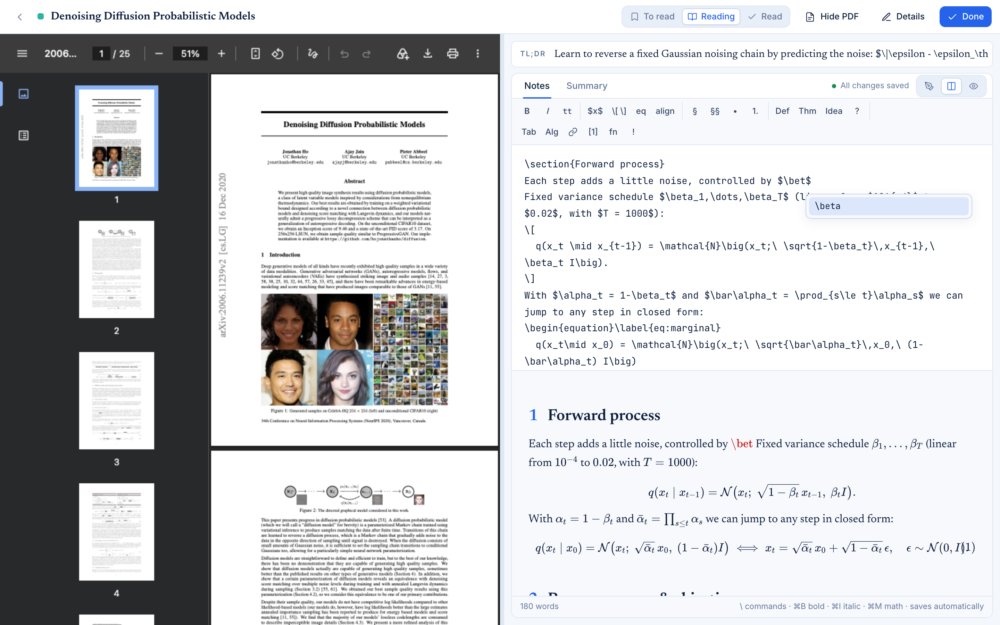
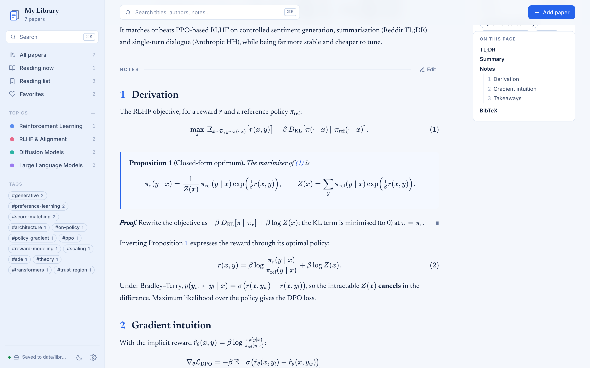
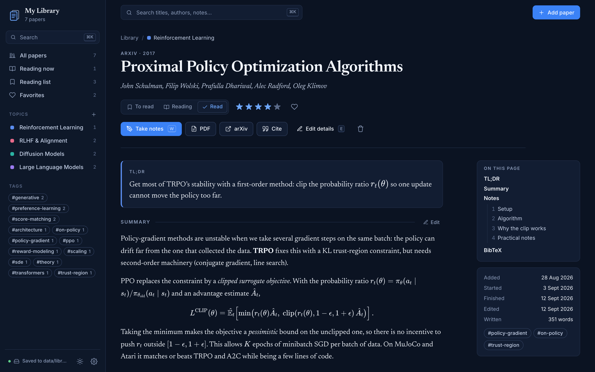
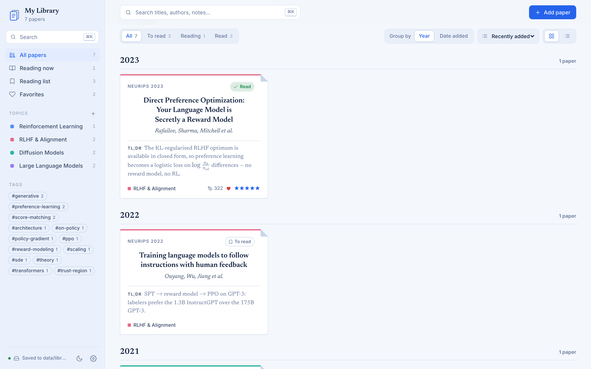
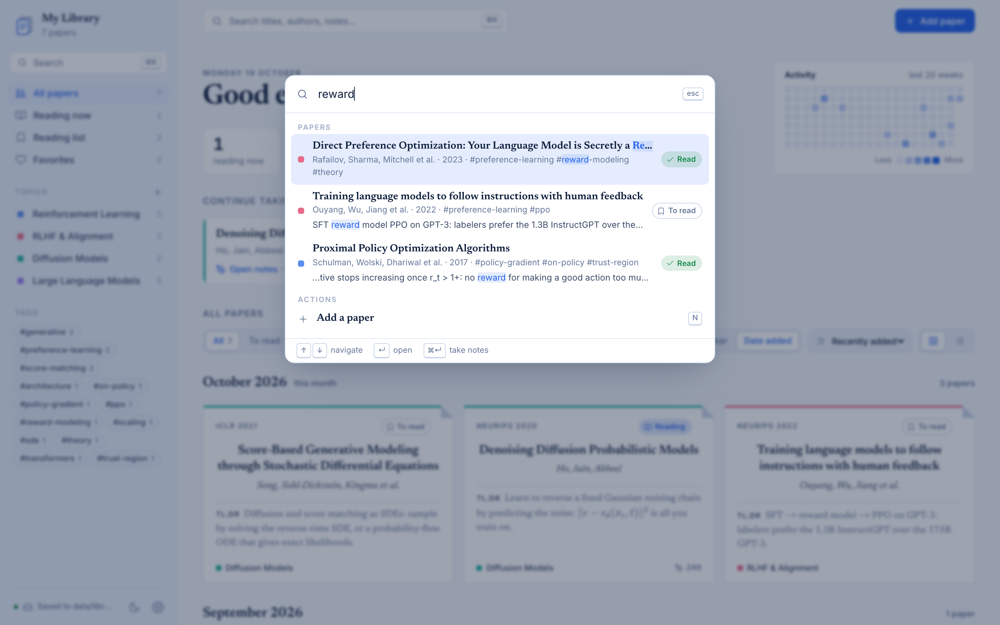

# Scientific Reading

A personal library for the research papers you read. Papers are organised by **topic** (RL, RLHF, Diffusion Models, …), and each one gets a TL;DR, a **summary** and **notes written in LaTeX**. Notes render with numbered equations, theorems, tables, algorithms, footnotes and cross-references.

It is a static site with no build step: plain HTML/CSS/JS plus [KaTeX](https://katex.org). It runs on your Mac as a one-click app, or on GitHub Pages.

**Live demo** (with example papers): https://elfirdoussilab1.github.io/Scientific-Reading/



## Screenshots

**Notes workspace**: the paper's PDF next to the LaTeX editor, with a live preview and command autocomplete.



<table>
  <tr>
    <td width="50%"><br><sub>Notes render like a paper: numbered equations, theorems, cross-references.</sub></td>
    <td width="50%"><br><sub>A paper page, here in the navy dark mode.</sub></td>
  </tr>
  <tr>
    <td width="50%"><br><sub>Group any list by publication year or by date added.</sub></td>
    <td width="50%"><br><sub>Search titles, authors, tags and the text of your notes (<code>/</code> or <code>⌘K</code>).</sub></td>
  </tr>
</table>

## Features

- **Papers that look like papers**: each card is styled like an article's first page, with the venue, the full title, the authors and the TL;DR. A table view is also available.
- **Grouping**: group any list by **publication year** or by **date added** (month by month). Within a group you can sort by date added, last edited, title, rating or year, and filter by status.
- **Notes workspace** (`W` on a paper): the PDF on the left and the LaTeX editor on the right, with a draggable divider. arXiv PDFs load automatically. You can switch between write, split (write + live preview) and preview.
- **Editor built for LaTeX**:
  - type `\` for command suggestions: `\alp` → `\alpha`, `\eq` → an `equation` environment, `\begin{al` → `align`, plus your own macros;
  - `{ ( [ $` close automatically;
  - `\begin{…}` + Enter adds its `\end{…}`, and Enter continues an `\item` list;
  - Tab / Shift-Tab indent and outdent;
  - `⌘B` / `⌘I` / `⌘M` insert bold, emphasis and inline math;
  - a snippet toolbar inserts definitions, theorems, ideas, open questions, tables and algorithms;
  - a live word count.
- **Autosave**: everything you type is saved automatically. A new paper is saved as soon as it has a title.
- **Auto-fill**: paste an arXiv link or ID, a DOI, a BibTeX entry or a title, and the title, authors, venue, year, abstract and links are filled in.
- **Reading workflow**: *To read → Reading → Read* status, a 1–5 rating, favourites, tags, an activity heatmap and a "Continue taking notes" row on the home page.
- **Search** (`/` or `⌘K`) across titles, authors, tags, summaries and notes. `⌘↵` opens a result straight in the notes workspace.
- **PDF export**: the **PDF** button (on a paper's page or in the notes workspace) typesets a paper's notes like an article: the title, authors and venue, the TL;DR, the abstract, the summary, the notes, and one References list for everything cited. Choose *Save as PDF* in the print dialog.
- Blue-and-white theme by default, with a navy dark mode toggle. Works on mobile. Exports to JSON or `.bib`.

## Your notes stay private

Your library is a single file, `data/library.json`. It is **git-ignored**, so it is never committed or pushed, even though this repository is public. Its automatic backups in `data/.backups/` are ignored too.

The repository ships with [`data/example-library.json`](data/example-library.json) instead, which holds seven example papers (PPO, DPO, InstructGPT, DDPM, Score SDE, Transformer, Scaling Laws). The app shows the example library until your own exists. Your first change creates `data/library.json`, and from then on the app uses only that file.

Because your library isn't in git, back it up now and then. Use **Settings → Data → Export library**, or keep a synced copy in a private repository (see [Sync through a private repository](#optional-sync-through-a-private-repository)).

## Use it on your Mac

### One-click app

```bash
./app/install-mac-app.sh     # builds "Scientific Reading.app" into ~/Applications
```

Then open **Scientific Reading** from Spotlight or Launchpad, or drag it to the Dock. Clicking it starts the library server in the background (only if it isn't running yet) and opens the library in a Google Chrome tab (or your default browser if Chrome isn't installed). The server stops by itself about 15 minutes after you close the tab. Logs go to `~/Library/Logs/ScientificReading.log`.

The app remembers where this folder lives, so run the script again if you move the repo. The first time, macOS may ask whether the app can access the folder that contains the repo (for example, Desktop). Click **Allow**.

## Use it on Linux (Fedora)

### Desktop app

```bash
./app/install-linux-app.sh     # adds "Scientific Reading" to your app grid
```

Then press <kbd>Super</kbd>, type *Scientific Reading* and open it; right-click its icon in the dock and choose **Pin to Dash** to keep it there. As on the Mac, it starts the library server in the background and opens the library in a Google Chrome tab (Chromium, or your default browser, if Chrome isn't installed). The server stops by itself about 15 minutes after you close the tab. Logs go to `~/.local/state/scientific-reading/server.log`.

It installs only for your user (nothing needs `sudo`) and uses Python 3, which Fedora ships with. It should also work on other distributions and desktops that follow the freedesktop standards (GNOME, KDE, …). Run the script again if you move the repo, and `./app/install-linux-app.sh --uninstall` to remove it; your library is not touched.

## From the terminal

```bash
python3 serve.py              # opens http://localhost:8642 in Chrome
python3 serve.py --port 9000  # if 8642 is taken
```

It needs nothing beyond Python 3. Every edit is written straight to `data/library.json`.

## Host it on GitHub Pages

1. In the repo, go to **Settings → Pages → Build and deployment**, choose *Deploy from a branch*, then **main** / **(root)**.
2. After a minute the site is live at `https://<username>.github.io/Scientific-Reading/`.

Your `data/library.json` is not in the repository, so the public site shows the **example library**. It works as a demo, and visitors get a read-only view.

### Optional: sync through a private repository

To read and edit your own notes from any browser, including the hosted page, keep the library in a **private** repository:

1. Create a private repository, for example `my-paper-notes`.
2. Create a [fine-grained personal access token](https://github.com/settings/personal-access-tokens/new) that covers **only that repository** and has **Repository permissions → Contents: Read and write**.
3. In the app, open **Settings → GitHub sync**. Enter the owner, the private repository, and a data file such as `library.json`. Paste the token and click **Connect**.
4. To start from your local library, use **Settings → Data → Import library** and pick your `data/library.json`.

Changes are then committed to the private repository. While you are typing notes, saves are batched into about one commit every 20 seconds. The token and the sync settings stay in that browser's `localStorage` and are never written into the library. If you point sync at a public repository, the app warns you that the notes would be public.

## Writing notes in LaTeX

Write the body of a document, without a preamble. Supported:

| | |
|---|---|
| Math | `$…$`, `\(…\)`, `$$…$$`, `\[…\]`, `equation`, `align`, `gather`, `multline`, `alignat` (+ starred), `\label` / `\eqref` / `\tag` |
| Structure | `\section`, `\subsection`, `\subsubsection`, `\paragraph`, `itemize`, `enumerate`, `description`, `\item[…]`, `quote` |
| Boxes | `theorem`, `lemma`, `proposition`, `corollary`, `definition`, `assumption`, `remark`, `example`, `claim`, `idea`, `intuition`, `question`, `critique`, `proof` (all with an optional `[title]` and `\ref`) |
| Floats | `table` + `tabular` (booktabs rules, `\multicolumn`), `figure` + `\includegraphics{https://…}`, `algorithm` + `algorithmic` (`\State`, `\If`, `\For`, `\While`, `\Return`, `\Comment`, …), `\caption` |
| Text | `\textbf`, `\emph`, `\texttt`, `\textsc`, `\underline`, `\textcolor`, `\hl`, `\href`, `\url`, `\footnote`, `\todo`, `verbatim` / `lstlisting`, `\verb`, accents, `--` / `---`, `` ``quotes'' `` |
| Citations | `\cite`/`\citep`, `\citet`, `\citealp`, `\citeauthor`, `\citeyear` of papers in your library, with `[pre][post]` notes (see below) |
| Macros | `\newcommand`, `\renewcommand`, `\DeclareMathOperator` in a note, or globally in **Settings → LaTeX macros** (defaults: `\E`, `\R`, `\KL`, `\norm`, `\argmax`, `\argmin`). Macros also show up in autocomplete. |

### Citing other papers

Cite any paper from a summary or notes. Type `\cite{` (or click **[1]** in the toolbar) and pick a paper from the suggestions, which match its title, authors, year or key. The key is the paper's BibTeX key if it has one, otherwise a generated one like `rafailov2023direct`; its id works too.

To cite a paper that is not on your reading list, pick **Cite a paper not in your library…** (the last suggestion). Paste an arXiv link, DOI, BibTeX entry or title, check the match, and click **Cite**. The paper is saved under `references` in `data/library.json`, so you can cite it again from any note, and it is included in **Export all BibTeX**. Tick *Also add it to my reading list* to add it as a *To read* paper instead.

Citations render author-year and link to the cited paper (its page in your library, or arXiv / the DOI for other papers): `\cite{…}` → (Rafailov et al., 2023), `\citet{…}` → Rafailov et al. (2023). A **References** list of the cited papers is added at the end. A key that matches no paper is shown in red.

`%` starts a comment, as in LaTeX. Unknown commands are shown in red instead of breaking the page.

## Data format

`data/library.json` (and the example file) is human-readable JSON:

```jsonc
{
  "settings": { "title": "…", "owner": "…", "macros": "…", "notesTemplate": "…" },
  "topics": [{ "id": "rlhf", "name": "RLHF & Alignment", "description": "…", "color": "#e86a8a" }],
  "papers": [{
    "id": "dpo", "title": "…", "authors": ["…"], "year": 2023, "venue": "NeurIPS 2023",
    "topics": ["rlhf"], "tags": ["preference-learning"], "status": "read", "rating": 5, "favorite": true,
    "links": { "arxiv": "…", "pdf": "…", "code": "…" },
    "tldr": "…", "abstract": "…", "summary": "LaTeX…", "notes": "LaTeX…", "bibtex": "",
    "added": "2026-09-22", "started": "2026-09-25", "finished": "2026-10-02"
  }]
}
```

## Layout

```
index.html                 app shell
assets/css/style.css       theme (blue & white by default, navy dark mode)
assets/css/print.css       layout of the PDF export
assets/js/app.js           views, grouping, notes workspace, search, dialogs
assets/js/editor.js        LaTeX editing: autocomplete, auto-pairs, smart Enter/Tab
assets/js/tex.js           LaTeX → HTML (text mode) + KaTeX (math)
assets/js/meta.js          arXiv / DOI / BibTeX lookups and BibTeX export
assets/js/store.js         storage: local server, GitHub API, or browser
serve.py                   local server (port 8642) that saves edits to data/library.json
app/                       desktop app: icon, install-mac-app.sh, install-linux-app.sh
data/example-library.json  example papers, shown until your own library exists
docs/screenshots/          images used in this README
```
