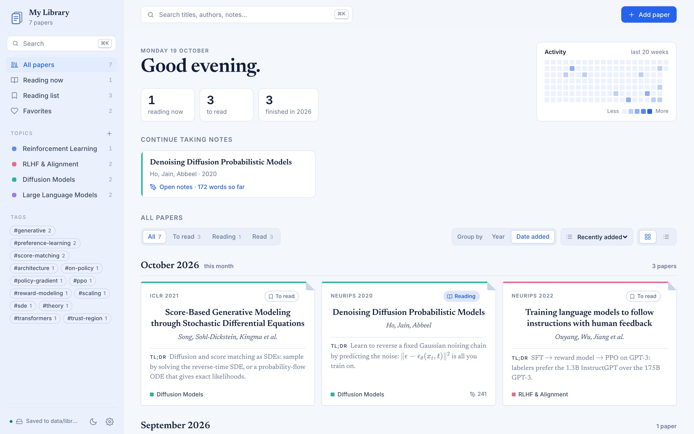
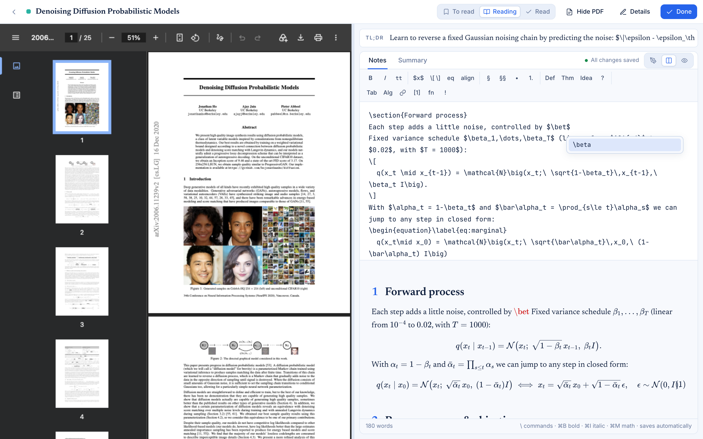

# Scientific Reading

A personal library for the research papers you read. Organise papers by topic, track what you're reading, and write your notes in **LaTeX** with a live preview next to the PDF.

No build step, no dependencies: plain HTML/CSS/JS with [KaTeX](https://katex.org), plus a small Python server that saves your edits.





## Features

- **Auto-fill**: paste an arXiv link, DOI, BibTeX entry, title or conference page (NeurIPS, PMLR, ACL, CVF, …) and the paper's details are filled in.
- **Notes workspace**: the PDF on one side, a LaTeX editor with autocomplete and live preview on the other.
- **LaTeX notes**: numbered equations, theorems, tables, algorithms, footnotes, cross-references and citations of other papers.
- **Reading workflow**: statuses (*To read → Reading → Read*), ratings, favourites, tags, and grouping by year or date added.
- **Search** across titles, authors, tags and notes.
- **Export** notes as a typeset PDF, and the library as JSON or BibTeX.
- Light and dark themes, works on mobile.

## Getting started

You only need **Python 3**.

```bash
git clone https://github.com/elfirdoussilab1/Scientific-Reading.git
cd Scientific-Reading
python3 serve.py              # opens http://localhost:8642
```

Use `--port 9000` if port 8642 is taken.

### Optional: install it as a desktop app

```bash
./app/install-mac-app.sh      # macOS: adds "Scientific Reading" to ~/Applications
./app/install-linux-app.sh    # Linux: adds it to your app launcher
```

The app starts the server in the background, opens the library in your browser, and stops the server about 15 minutes after you close the tab. Run the script again if you move the folder.

## Your data

- Your library is saved to `data/library.json`, with automatic backups in `data/.backups/`. Both are **git-ignored**, so your notes are never committed.
- Until you make your first change, the app shows a few example papers from `data/example-library.json`.
- Back up your library from time to time with **Settings → Data → Export library**.

### Sync across devices (optional)

You can keep your library in a **private** GitHub repository and edit it from any browser:

1. Create a private repository (e.g. `my-paper-notes`).
2. Create a [fine-grained token](https://github.com/settings/personal-access-tokens/new) for that repository only, with **Contents: Read and write**.
3. In the app, open **Settings → GitHub sync**, enter the repository and token, and click **Connect**.
4. To bring in your local notes, use **Settings → Data → Import library**.

The token is stored only in your browser. You can also host the app itself on GitHub Pages (**Settings → Pages → Deploy from branch `main`**) and use sync from there.

## Writing notes

Write the body of a LaTeX document (no preamble). Most of what you'd use in a paper works:

- **Math**: `$…$`, `\[…\]`, `equation`, `align`, `\label` / `\eqref`
- **Structure**: sections, `itemize`, `enumerate`, `quote`
- **Boxes**: `theorem`, `lemma`, `definition`, `proof`, `remark`, `idea`, `question`, …
- **Floats**: `table` / `tabular`, `figure`, `algorithm` / `algorithmic`
- **Citations**: type `\cite{` to cite a paper from your library, or any paper via its arXiv link, DOI or title. A References list is added automatically.
- **Macros**: define them with `\newcommand` in a note, in **Settings → LaTeX macros**, or in [`maths.tex`](maths.tex) (available in every note).

Unknown commands are shown in red instead of breaking the page.

**Editor shortcuts**: `\` for suggestions, `⌘B` / `⌘I` / `⌘M` for bold, italic and inline math, `/` or `⌘K` to search, `W` on a paper to open the notes workspace.
